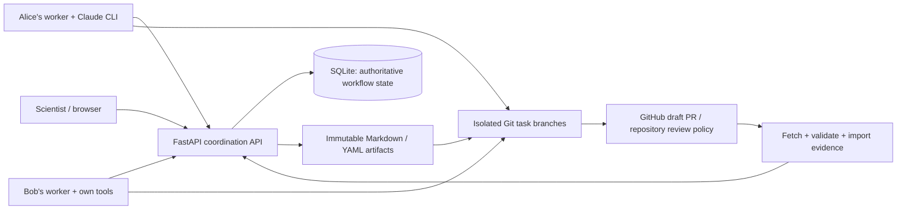
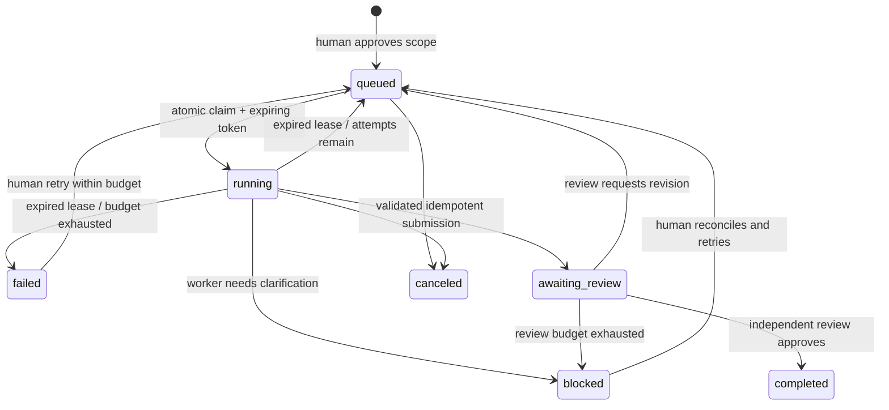

# ResearchRelay

A working experiment for a small scientific team whose participant agents collaborate asynchronously. Scientists approve scope and make scientific decisions; workers perform routine work and exchange portable evidence. The application is **ResearchRelay**; the Python package and CLI are `researchrelay`.

## Start here

Run from this checkout (`D:\ResearchRelay` on the development machine). Git and mamba must be installed.

The source is in [midatm1234/new](https://github.com/midatm1234/new). Clone it into the application directory with `git clone git@github.com:midatm1234/new.git ResearchRelay`.

```powershell
mamba env create -f environment.yml
mamba run -n researchrelay researchrelay serve --port 8000
```

The environment has already been created on the development machine. Open **http://127.0.0.1:8000**, then choose **Run local pilot**. The browser can close while the service and workers continue.

To run the same demonstration from another terminal against the dashboard's default database:

```powershell
mamba run -n researchrelay researchrelay demo
```

Use the button or CLI once; both coordinate through the same SQLite database. To run an independent fresh experiment without deleting existing work:

```powershell
mamba run -n researchrelay researchrelay demo --db .runtime/session-2.db --repo .runtime/session-2-record
```

To show that independent experiment in the dashboard, start a separate service:

```powershell
$env:RESEARCHRELAY_DB = '.runtime/session-2.db'
$env:RESEARCHRELAY_REPO = '.runtime/session-2-record'
mamba run -n researchrelay researchrelay serve --port 8001
```

API documentation: **http://127.0.0.1:8000/docs**. Configuration: copy `.env.example` to `.env` and edit. Runtime state and credentials are Git-ignored.

## The pilot

The bundled [meeting notes](examples/meeting-notes.txt) and [synthetic daily data](examples/forecast.csv) drive the following sequence:

1. Meeting notes become an attributable summary, explicit decisions with rationale, editable task proposals, and open questions. Demo scope approval is scripted and labeled; ordinary meeting intake requires the participant to edit and approve the proposals.
2. Alice and Bob's simulated participant agents score separate forecasts concurrently in isolated Git worktrees. They run actual Python calculations and record data/code hashes and environment details.
3. Carol reviews their results; only reviewed dependencies unlock the synthesis task. Synthesis pins exact versions of both result artifacts.
4. Carol requests a justified revision: the initial comparison uses unequal dates and lacks uncertainty. Alice produces a second version using paired dates and a seeded bootstrap, with methodological limitations.
5. Reviewed changes and completion notes enter the local project Git history. Portable meeting, task, result, review, and decision records are exported with a generated dashboard snapshot.
6. The dashboard asks a human which next evaluation to prioritize, presenting evidence, options, and the consequences for subsequent work. The human's answer and rationale become a new decision artifact version.

This is **local demonstration mode**: deterministic agents, real scientific calculations, real SQLite and Git, simulated pull requests. It requires no Claude or GitHub credentials. No model calls, GitHub push, PR creation, or cloud deployment are implied by a successful local run.

The bootstrap uses independent resampling of a very small synthetic daily sample. It illustrates a reviewable workflow; it does not support a scientific generalization or a productivity claim.

## Architecture and assumptions



- **One project per service/database.** Intended for a trusted small team and one service process, with SQLite WAL transactions fencing concurrent claims and submissions. This is not a multi-tenant hosted product.
- **Coordination is separate from execution.** FastAPI serves the dashboard and workflow API. Participant workers poll persistent tasks and run in their own environments. The server's demo runner launches only the bundled synthetic experiment.
- **SQLite owns execution state.** Tasks, attempts, leases, events, immutable artifact versions, submissions, review records, decisions, measures, and demo job status survive browser closure and restarts. No in-memory queue owns task work.
- **Git preserves the project record.** Immutable artifact exports, task code/results, and derived dashboard snapshots are reviewable outside the application. Editing a snapshot does not change task state. Imported artifact changes become evidence; execution or scope changes still use explicit API operations.
- **Conservative meeting extraction.** The initial local parser recognizes explicit decision/question markers, structured task lines, and simple named assignments. Inferred owners, criteria, outputs, and dependencies are visible and editable. It preserves source notes and does not claim comprehensive natural-language understanding.
- **Scientific authority stays human.** A computational submission enters `awaiting_review`; independent agent approval allows downstream work. A scientific decision requires a participant's choice and rationale. Resolving a decision never launches new scientific scope automatically.

See [artifact format and schemas](docs/artifacts.md), [worker and Git integration](docs/worker.md), and the [implementation contract](docs/CONTRACT.md).

## State and reliability



Claims default to 120 seconds. Heartbeats renew them; only the active claim token may submit. Lease expiry fences the previous worker and consumes an attempt. A task has five attempts by default (maximum ten) and at most two requested revisions; further disagreement becomes a visible human decision. Workers stop their Claude subprocess after claim loss or execution timeout.

Submissions require a durable idempotency key. The first submission, artifact, event, and task transition commit atomically; exact replays return the stored response, including after restart. Reusing the key with different content is rejected. Artifact versions are immutable and sequential. Reviews name the exact result version. Task dependencies form a validated DAG and require reviewed completion. Workers use a private, locally ignored exchange directory and commit task-specific records, allowing independent output branches to merge without shared exchange-file conflicts.

Input versions are pinned when work is claimed. A newer input artifact disables readiness or prevents submission and shows the conflicting versions. In task details, a human can inspect both versions and explicitly approve updated pins for queued or blocked work. The API also accepts explicitly reconciled `input_refs`; the service does not silently change the evidence beneath an ongoing task.

The demo job launcher persists its status. Restarted service jobs are labeled `interrupted`; rerunning the pilot resumes supported stages. Arbitrary worker processes resume by polling durable task state after lease expiry. Worktrees and saved submission payloads remain available for recovery.

## Claude and GitHub integration

The installed Claude CLI is the initial execution adapter. Each participant logs in and supplies their own clone, local tools, and project token. The coordinator never needs their Claude credentials.

```powershell
# In Alice's own environment and project clone:
$env:RESEARCHRELAY_TOKEN = 'alice-project-secret'
mamba run -n researchrelay researchrelay worker --participant alice --repo D:/research/project --server http://127.0.0.1:8000 --once
```

The default Claude tools cover reading/writing artifacts. For execution, explicitly configure the worker's `--allowed-tools` to match authorized commands and local Claude permission rules; see [worker documentation](docs/worker.md). API-only/manual adapters can use the same task, claim, heartbeat, submit, block, and review endpoints without any provider dependency.

Live publication is opt-in. Configure `origin` to the explicit GitHub project, authenticate `gh` in the participant's environment, and publish a task branch through a draft PR. The adapter verifies the destination, reuses an existing open PR, and never merges; repository protection and review rules remain in force. Fetch is fast-forward only. New versions edited directly in GitHub can be fetched and imported; conflicting immutable edits and divergent branches require reconciliation.

```powershell
mamba run -n researchrelay researchrelay publish --repo D:/research/project --github TEAM/PROJECT --branch tasks/forecast-a/attempt-1 --title 'Forecast A evaluation' --body-file proposal.md
```

Run fetch/import/export on the **coordinator host** against its authoritative database and configured project-record clone. A remote participant publishes their task branch; they do not maintain a second execution-state database. The coordinator can fetch reviewed changes and export updated records on a separate records branch for another draft PR:

```powershell
# On the coordinator host; use the repository path from RESEARCHRELAY_REPO.
mamba run -n researchrelay researchrelay fetch --repo D:/research/project-record --branch main
git -C D:/research/project-record switch -c records/session-1
mamba run -n researchrelay researchrelay export --repo D:/research/project-record
mamba run -n researchrelay researchrelay publish --repo D:/research/project-record --github TEAM/PROJECT --branch records/session-1 --title 'Session project record' --body-file record-proposal.md
```

The Claude invocation follows its [programmatic CLI interface](https://code.claude.com/docs/en/headless). Live PR operations use the [GitHub CLI](https://cli.github.com/manual/gh_pr_create). Live model execution and remote publication require a configured participant session and were not exercised in the credential-free smoke test.

## Team access and data

The default server binds to loopback and rejects unauthenticated nonlocal API traffic. For team access, configure `RESEARCHRELAY_TOKENS` as a JSON mapping from random project tokens to participant names; `human` is the coordination role. Workers may claim and submit only their owner's tasks; review identity must match the token. All tokens belong to this single project. Use a private network and HTTPS reverse proxy for remote access. The dashboard accepts a session token without adding it to exported artifacts.

Git worktrees isolate filesystem changes and branches; they are **not an OS security sandbox**. Participants should use their own container/VM or restricted account for untrusted agent work. The system trusts participants' project access. Do not expose this pilot directly to the public internet.

Keep datasets, model checkpoints, and large outputs in external storage. Artifact provenance records should include a storage URI, checksum/version, access instructions, code commit, parameters, environment, evidence, assumptions, and limitations. Credentials never belong in notes, result bodies, tracked files, or storage URLs. Validation rejects named secret fields in metadata, but human text and arbitrary file contents still need normal repository secret controls.

Back up the database together with its project repository. Use SQLite's backup facility or stop the service before copying the database; copying a live `.db` alone can miss WAL transactions.

## Working-session evaluation

Use the dashboard assessment to record actual human coordination minutes, a 1–5 rating of handoff clarity, and a short observation. The worker/API can additionally record clarification requests. Derived measures include task execution time, review cycles, rework, and unresolved blockers. Demo-generated measures are labeled as scripted or derived, and missing human measures remain unmeasured.

Suggested session: paste or inspect the supplied notes, correct proposed scope, run the local pilot, inspect the first and revised synthesis, resolve the scientific decision with a rationale, and record whether you understand what others completed and what needs attention next. Compare coordination time and comprehension with your existing process before claiming a productivity gain.

## Verification and limits

```powershell
mamba run -n researchrelay python -m pytest -q
```

Tests cover the scientific pilot and Git history, interrupted execution and claim fencing, competing claims, duplicate and conflicting submissions, dependency gating and stale versions, review/revision bounds, artifact validation, cancellation, repository update conflicts, direct Git imports, and API project-token scope. See [verification report](docs/verification.md) for the actual run and browser-check results.

The environment file installs the verified versions in `requirements.lock.txt`. Optional real-browser verification uses a fresh isolated service because it writes synthetic QA records:

```powershell
mamba run -n researchrelay python -m pip install -e '.[browser]'
$env:RESEARCHRELAY_DB = '.runtime/browser-check.db'
$env:RESEARCHRELAY_REPO = '.runtime/browser-check-record'
mamba run -n researchrelay researchrelay serve --port 8767
# In another terminal, with the service running:
mamba run -n researchrelay python scripts/ui_smoke.py --url http://127.0.0.1:8767
```

The browser script defaults to installed Microsoft Edge on Windows; pass `--browser` with a local Chrome/Chromium executable on another platform.

Known limits: one project and one coordinator process; rule-based meeting extraction; local worker worktrees rather than security sandboxes; manual reconciliation for imported task scope changes; small-team static tokens rather than institutional SSO; no remote GitHub or Claude execution validated without a chosen project/session. Package installation supports the service and worker, while the bundled pilot expects the source checkout's `examples/` directory.

The most useful next step is a real two-participant session using Claude workers against a designated GitHub repository. Use the resulting clarification/review data to improve meeting extraction and task-scope editing before adding providers or orchestration complexity.
