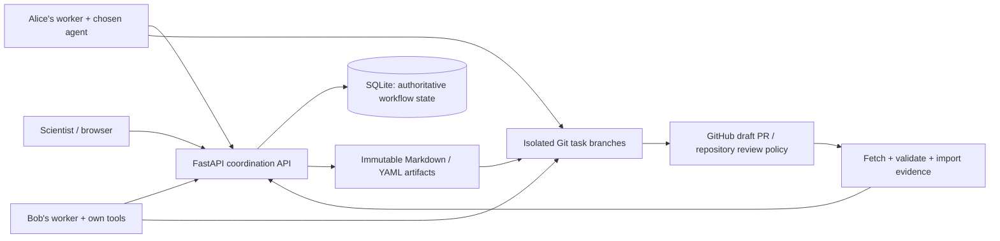
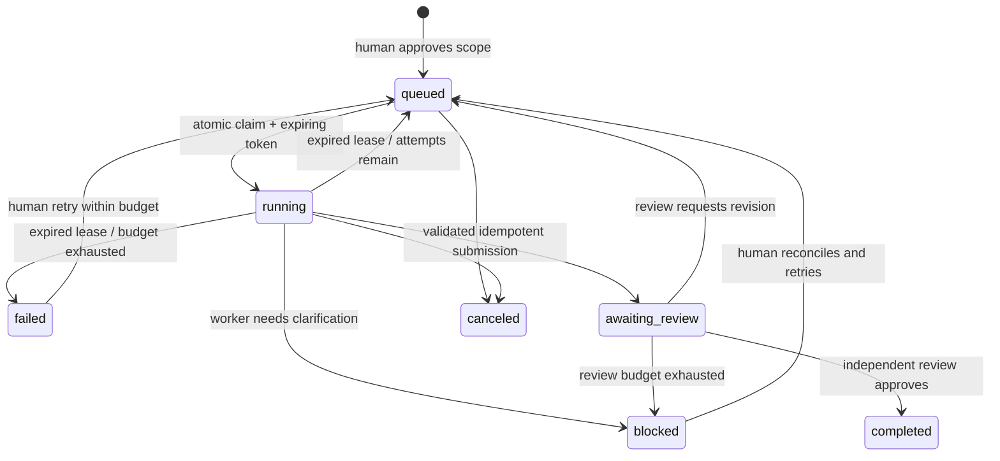

# ResearchRelay

A working experiment for a small scientific team whose participant agents collaborate asynchronously. Scientists approve scope and make scientific decisions; workers perform routine work and exchange portable evidence. The application is **ResearchRelay**; the Python package and CLI are `researchrelay`.

## Start here

Use Python 3.12 and Git 2.28 or newer. The web interface has no Node.js build step; SQLite is included with Python. [macOS setup](#macos-setup-apple-silicon-and-intel) below covers Apple Silicon and Intel.

The default workspace at `/workspace` (also `/` before GitHub sign-in is configured) uses **[midatm1234/ResearchRelay](https://github.com/midatm1234/ResearchRelay), branch `SRTD_DT_test`, directory `projects/agentic-collaboration`** as its shared knowledge base. The source-code checkout may be on `main`; the configured knowledge branch still determines what agents retrieve. Start from a source checkout:

```bash
git clone https://github.com/midatm1234/ResearchRelay.git
cd ResearchRelay
mamba env create -f environment.yml
mamba run -n researchrelay researchrelay serve --port 8000
```

Open **http://127.0.0.1:8000/workspace** for the default dashboard. It retrieves committed project knowledge and shows the repository, branch, commit, and actionable synchronization errors. The service host needs SSH read permission for `git@github.com:midatm1234/ResearchRelay.git`; publication additionally needs write permission and is an explicit action. Starting or opening the service does not push changes. Each worker uses its participant's own Git access. To check read access:

```bash
git ls-remote git@github.com:midatm1234/ResearchRelay.git refs/heads/SRTD_DT_test
```

Local services automatically reload when the application's Python files change, including after a Git pull. Refresh the browser to load the latest HTML, JavaScript, CSS, and project state. Runtime databases and Git caches are outside the watched directory. Use `researchrelay serve --no-reload` for a stable process; non-loopback services disable automatic reload by default.

To start, stop, restart, or check the local service, use `scripts/researchrelay.sh {start|stop|restart|status} [port]` on macOS/Linux or `.\scripts\researchrelay.ps1 {start|stop|restart|status} [-Port 8000]` in Windows PowerShell. Both default to port 8000 and the `researchrelay` mamba env (override with `RESEARCHRELAY_ENV`), and log to `.runtime/serve.log`.

Run commands from the checkout. Team members use **Projects** and sign in with their own GitHub accounts. **My agent** stores each participant’s connection profile. The default workspace is a local operator view; authenticated team projects have isolated execution databases and repository bindings.

On each computer, the Projects page searches the default branches of accessible GitHub repositories for shared `PROJECT.md` records and adds them to its local catalog. **Refresh list** repeats discovery, including additional repository pages. This reads GitHub without creating repositories, committing files, or starting tasks. For a project on another branch, use **Existing branch** and join its existing knowledge folder.

Separate local installations can share project metadata and committed research files through GitHub; they do not need a shared HTTPS server for those records. Live task claims, attempts, approvals, and execution state currently belong to one coordinator database. Participants who need the same live task queue must connect to that coordinator; discovery does not merge or synchronize execution databases. `127.0.0.1:8000` reaches the current computer unless an explicit tunnel connects it elsewhere.

### Create or join a project

For local browser sign-in, follow the [GitHub sign-in setup guide](docs/github-sign-in-setup.md), including callback/redirect URL configuration and project visibility troubleshooting.

Open **http://127.0.0.1:8000/projects**, or choose **Projects** / **New Project** in the dashboard. The hub uses each participant's own GitHub account; the original workspace remains available at `/workspace` as **Default workspace**. With OAuth configured or `--project-demo`, `/` opens the project hub.

The service owner first registers a GitHub OAuth App with homepage `http://127.0.0.1:8000` and callback **`http://127.0.0.1:8000/api/hub/auth/callback`** for loopback development. Set the following in the server's private `.env`, replacing placeholders, then start the normal service:

```dotenv
RESEARCHRELAY_PUBLIC_URL=http://127.0.0.1:8000
RESEARCHRELAY_GITHUB_CLIENT_ID=YOUR_OAUTH_APP_CLIENT_ID
RESEARCHRELAY_GITHUB_CLIENT_SECRET=YOUR_SERVER_ONLY_OAUTH_APP_SECRET
RESEARCHRELAY_HUB_PATH=.runtime/project-hub
```

For a deployed service use its HTTPS origin and matching OAuth callback. **Connect GitHub** completes sign-in; the browser receives an HTTPOnly session cookie rather than a token to paste. Missing configuration, expired authorization, repository access failures, and organization/branch policy errors remain visible. No machine-wide GitHub CLI account is silently substituted. See [GitHub authentication and permissions](docs/github-auth.md) for scope, encryption-key storage, session expiry, worker credentials, and deployment limits.

Choose **New Project**, enter its name, description, research objectives, and collaborator usernames, then select a home:

- **New repository:** create a separate repository in the selected account/organization. Visibility defaults to **Private**.
- **New branch:** choose an accessible repository, its base branch, and a new project branch.
- **Existing branch:** initialize a unique project folder in an existing branch. To join another participant's project, uncheck **Initialize a new project record** and enter its existing knowledge folder containing `PROJECT.md`.

Collaborator names are a project record only. Before another participant joins or works, grant repository access in GitHub; ResearchRelay does not send invitations or elevate permissions automatically. Access is checked against the connected account's current GitHub permissions. Repository dropdowns offer additional pages when available.

Initialization commits portable `README.md`, `AGENTS.md`, `PROJECT.md`, `TASKS.md`, `MEETINGS.md`, `KNOWLEDGE.md`, `DECISIONS.md`, and an index under the chosen project folder. It preserves existing content and branch policies. Objectives remain proposals: no task, meeting agreement, scientific finding, or approval is fabricated. Partial setup exposes its operation status and recovery action. Use **Check setup status → Resume setup** to reuse the original saved request after a restart. A request that needs reconciliation must be inspected before retrying; the UI does not offer automatic resume for it. No recovery action deletes existing resources or changes the saved scope. An authenticated original actor may also resume using the API below, with their GitHub PAT read from the environment rather than a command argument:

```bash
mamba run -n researchrelay python -c 'import subprocess,httpx; r=httpx.post("http://127.0.0.1:8000/api/hub/operations/REQUEST_ID/resume",headers={"Authorization":"Bearer "+subprocess.check_output(["gh","auth","token","--hostname","github.com"],text=True).strip()},timeout=120,trust_env=False); r.raise_for_status(); print(r.json()["operation"]["status"])'
```

Project cards **Open**, **Edit details**, **Refresh**, and show **Repository activity**. Metadata edits update the shared `PROJECT.md`. A second participant signs in and discovers the shared project, or joins its repository/branch/folder explicitly. Its dashboard and task API live at `/projects/PROJECT_ID` and `/projects/PROJECT_ID/api`; each project has isolated workflow state, context pins, and browser catch-up state. Legacy default-workspace bearer tokens are never forwarded by the browser to these project routes. The default literature bundle stays in its original workspace; newly created projects start with an empty, explicitly proposed record.

Each worker uses the participant’s existing GitHub CLI login and actual GitHub username. Sign in once and select the managed project before starting work:

```bash
gh auth login --hostname github.com
export RESEARCHRELAY_SERVER=http://127.0.0.1:8000/projects/PROJECT_ID
mamba run -n researchrelay researchrelay worker --server http://127.0.0.1:8000/projects/PROJECT_ID --participant YOUR_GITHUB_LOGIN --repo "$HOME/Projects/my-agent-clone" --provider vscode --once --timeout 3600
```

The task must first be assigned and approved for that identity. Claude/API/command connections use the same scoped server URL and their own provider credentials. A consumer chat subscription does not grant GitHub or provider API access.

To evaluate project creation without GitHub credentials:

```bash
mamba run -n researchrelay researchrelay serve --project-demo --port 8000
```

Open **http://127.0.0.1:8000/projects** and choose **Continue as Alice**. Create a private repository/project, then use **Continue as Bob** to join its existing folder. This explicitly labeled mode simulates GitHub accounts/API responses with real local Git and HTTPOnly local sessions. It creates no GitHub resources and invokes no model or extension. It uses separate `.runtime/project-demo/` state and is distinct from the cached literature demonstration below.

Browser verification (install `.[browser]` and Playwright Chromium first):

```bash
mamba run -n researchrelay python scripts/project_smoke.py
mamba run -n researchrelay python scripts/ui_projects_smoke.py
mamba run -n researchrelay python scripts/ui_projects_smoke.py --demo
```

The CLI smoke starts a disposable service, runs two participant-owned scripted command agents through task dependencies and independent reviews, publishes results with the real CLI, and rejects a stale edit. It uses supplied verified literature rather than fresh model inference. The browser script without flags uses mocked hub API contracts, including interrupted-request recovery and access failures. `--demo` starts its own temporary real HTTP service and local Git repositories and exercises all three modes, editing, activity, a second participant joining, and the scoped dashboard. Neither establishes live OAuth consent or GitHub resource creation.

### Credential-free offline demonstration

Use an explicit offline service to try the deterministic literature workflow without GitHub or model credentials:

```bash
mamba run -n researchrelay researchrelay serve --offline-demo --port 8001
```

Open **http://127.0.0.1:8001** and choose **Run literature pilot**, or run the same workflow from another terminal:

```bash
mamba run -n researchrelay researchrelay demo --offline
```

Both use `.runtime/offline-demo/state.db` and `.runtime/offline-demo/project-record`, separate from the shared project. Use the button or CLI once; they coordinate through that same offline database. For another independent session, pass matching `--db .runtime/session-2.db --repo .runtime/session-2-record` to both offline commands. Offline flags disable browser OAuth and only serve loopback; an existing bound database is refused rather than erased or detached. Closing a browser does not stop the service/workers; stop a service with Ctrl+C.

API documentation: **http://127.0.0.1:8000/docs** (port 8001 for the offline service). Runtime state, `.env`, and credentials are Git-ignored. An explicitly empty `RESEARCHRELAY_GITHUB_URL` disables the startup fallback for a new unbound project; it does not replace a binding already saved in that project's database.

## macOS setup (Apple Silicon and Intel)

Intel macOS uses `cryptography==48.0.1`, the last release with a universal Mac wheel; Apple Silicon, Windows, and Linux use `50.0.2`. Both the package requirements and lock file select the correct version automatically, including an Intel Python under Rosetta. This avoids requiring a Rust/OpenSSL source build. ResearchRelay uses Fernet only; the Intel compatibility pin needs ongoing review because [upstream removed Intel support in version 49](https://cryptography.io/en/50.0.2/changelog/#v49-0-0).

### Prerequisites and architecture

- Install Git 2.28+ (`git --version`). Apple's Command Line Tools provide Git; run `xcode-select --install` if they are missing and finish the installer before continuing.
- Install [Miniforge3](https://github.com/conda-forge/miniforge#requirements-and-installers) for your native architecture: **arm64** on Apple Silicon, **x86_64** on Intel. Current Miniforge installers require macOS 11+. Open a new Terminal after the installer initializes your shell so `mamba --version` works. These are upstream installer requirements, not a claim that every macOS version has been tested with this application.
- Use a native Terminal on Apple Silicon, rather than a Terminal opened using Rosetta. `uname -m` should report `arm64` on Apple Silicon and `x86_64` on Intel. Keep Miniforge, Python, and their packages on the same architecture. No GPU, CUDA, Homebrew, Docker, or Rosetta is required for the pilot.
- Keep the checkout and runtime directories in a user-writable location, such as `~/Projects/ResearchRelay`. Do not use `sudo pip`, change system Python, or grant Full Disk Access just to start this service. Git worktrees need a local writable filesystem; avoid read-only or cloud-synchronized project-record directories.

Miniforge's base Python version can differ from the application environment. `environment.yml` creates a separate native **Python 3.12** environment on either Mac architecture. The pinned native dependencies have CPython 3.12 wheels for both architectures; using the pinned interpreter avoids unnecessary local C/Rust builds. An already installed environment can be inspected with:

```bash
uname -m
git --version
mamba --version
mamba run -n researchrelay python -c 'import platform; print(platform.python_version(), platform.machine())'
```

### Install and configure

After installing the prerequisites, use a normal zsh/bash Terminal:

```bash
mkdir -p "$HOME/Projects"
cd "$HOME/Projects"
git clone https://github.com/midatm1234/ResearchRelay.git
cd ResearchRelay
mamba env create -f environment.yml
cp .env.example .env
```

If you already cloned the repository, start with `cd` into that checkout instead. If the `researchrelay` environment already exists, use `mamba run -n researchrelay python -m pip install -r requirements.lock.txt -e ".[dev]"` to update its dependencies. Quote extras such as `".[dev]"` in zsh to prevent filename expansion.

Edit `.env` with your text editor. Its default `RESEARCHRELAY_MODE=live` retrieves the shared knowledge branch using the host’s Git access. Configure GitHub browser sign-in for team use. For a local pilot, use the explicit offline commands below. Runtime paths may use `~` and spaces, for example:

```dotenv
RESEARCHRELAY_DB="~/Library/Application Support/ResearchRelay/state.db"
RESEARCHRELAY_REPO="~/Library/Application Support/ResearchRelay/project-record"
```

Relative paths are resolved from the directory where the command runs; `~` expands to your home directory. Keep using the same `.env` and working directory in both terminals. The application creates the state/worktree directories with your normal account permissions. `.env` is ignored by Git; do not put provider credentials in project artifacts.

### Start, demonstrate, and test

Terminal 1, from the checkout:

```bash
mamba run -n researchrelay researchrelay serve --host 127.0.0.1 --port 8000
```

Open **http://127.0.0.1:8000** to retrieve shared knowledge. For the credential-free demonstration, start a separate service with `mamba run -n researchrelay researchrelay serve --offline-demo --port 8001` and open **http://127.0.0.1:8001**. In Terminal 2, `cd` into the same checkout and run the offline demonstration, or use that offline dashboard's **Run literature pilot** button:

```bash
mamba run -n researchrelay researchrelay demo --offline
mamba run -n researchrelay python -m pytest -q
mamba run -n researchrelay python -m pip check
mamba run -n researchrelay python scripts/smoke.py
```

`scripts/smoke.py` starts and stops its own service on a temporary loopback port, using an isolated database/project repository. It checks HTTP startup, parallel source-note processing, dependent synthesis, review/revision, Git records, and the human decision. It does not alter your working-session state. The full test suite also exercises paths containing spaces and non-ASCII text, home-relative paths, interruption, and concurrency.

To build the wheel without adding a separate build tool:

```bash
mamba run -n researchrelay python -m pip wheel --no-deps --wheel-dir .runtime/dist .
```

For a Python-only setup, install a native Python 3.12 interpreter first, then run `python3.12 -m venv .venv`, `source .venv/bin/activate`, and `python -m pip install -r requirements.lock.txt -e ".[dev]"` from the checkout. Replace `mamba run -n researchrelay` in subsequent commands with the active environment's command (for example, `python scripts/smoke.py` or `researchrelay serve`). Never reuse a Windows virtual environment on a Mac.

### Optional browser and live-worker checks

The service works in your normal browser without Playwright. Automated browser tests use [Playwright-managed Chromium](https://playwright.dev/python/docs/browsers), on either architecture, rather than a Windows executable path. Current [Playwright requirements](https://playwright.dev/python/docs/intro#system-requirements) specify macOS 14+ for this optional test tool.

```bash
mamba run -n researchrelay python -m pip install -e ".[browser]"
mamba run -n researchrelay python -m playwright install chromium
mamba run -n researchrelay python scripts/smoke.py --browser
```

For an existing Chrome installation, `scripts/ui_smoke.py --browser "/Applications/Google Chrome.app/Contents/MacOS/Google Chrome"` selects that executable; the complete isolated-service invocation is documented in [verification](#verification-and-limits). Safari is usable as an ordinary browser, but this Chromium smoke does not automate Safari.

Optional live connections need their own tools: VS Code plus a signed-in extension for the editor handoff, Claude CLI for `claude-cli`, or provider credentials for API adapters. The draft-PR path additionally uses `gh`. Install/authenticate the tools you select in the same environment that starts the worker. Claude macOS example:

```bash
gh auth login --hostname github.com
export RESEARCHRELAY_SERVER=http://127.0.0.1:8000/projects/PROJECT_ID
mamba run -n researchrelay researchrelay worker --participant alice --repo "$HOME/Projects/team-project" --server http://127.0.0.1:8000/projects/PROJECT_ID --once
```

Use your actual GitHub login, managed project URL, and local repository path. Default worker tools support files; authorize scientific execution tools separately as described in [worker integration](docs/worker.md).

The [macOS compatibility workflow](.github/workflows/macos.yml) runs native Python 3.12 on Apple Silicon and Intel macOS 15 runners, including tests, a wheel build, service/pilot smoke, and browser smoke. See [verification results](docs/verification.md) for actual execution results and remaining limitations; a passing dependency download on Windows alone is not macOS execution.

## The local literature pilot

The bundled [meeting notes](examples/meeting-notes.txt) and [verified literature source notes](projects/agentic-collaboration/sources) drive the explicit offline demonstration. Its 2026-11-04 [search record](projects/agentic-collaboration/search-record.md) records what was actually searched and inspected.

1. Meeting notes become an attributable summary, explicit decisions with rationale, editable task proposals, and open questions. Demo scope approval is scripted and labeled; ordinary meeting intake requires a participant to edit and approve proposals.
2. Alice inventories human–AI collaboration evidence while Bob inventories multi-agent coordination evidence concurrently in isolated Git worktrees. Local Python scripts read the verified notes and record their exact data/code hashes and environment.
3. Carol reviews the two evidence inventories. Only reviewed dependencies unlock Alice's synthesis, which pins both input artifact versions.
4. Carol requests a justified revision because the first synthesis omits publication-status and source-access limitations. The revised synthesis distinguishes 7 published papers, 2 preprints, 2 specifications, and 1 software manual and explains the limits of abstract-based evidence.
5. Reviewed results, source provenance, completion notes, and portable meeting/task/review/decision records enter the local Git history with a generated dashboard snapshot.
6. The dashboard presents source coverage and asks a human which evidence gap to investigate next: update the search, audit full-text methods, or design a small-team handoff evaluation. The participant's choice and rationale become a new decision artifact version.

This is **local demonstration mode**: deterministic scripted agents, real note processing, real SQLite and Git, and simulated pull requests. It needs no model or GitHub credentials. It performs **no fresh literature search or live model inference** and does not push to GitHub. The source notes retain the evidence access limits of the original search; this run does not convert them into a systematic review or establish productivity gains.

The offline **Run literature pilot** button and `researchrelay demo --offline` run this same workflow. Use an unbound offline database/repository: a configured shared project hides this button and rejects a local demo to preserve its scope. The separate `researchrelay literature-pilot` below demonstrates publication and handoff through a shared Git remote. Inspect the [executed example records](examples/literature-record) without running the service.

## Shared GitHub projects and participant agents

Each ResearchRelay project has one authoritative execution database and knowledge binding, with multiple authenticated participants and participant-owned workers. The hub hosts several isolated projects in one service; the default workspace remains separate. GitHub preserves committed project knowledge; SQLite remains authoritative for task claims, attempts, reviews, and execution state. Browser polling retrieves other participants' changes without requiring an always-open browser or a messaging service.

### Use the default or choose another knowledge repository

The initial review is in [projects/agentic-collaboration](projects/agentic-collaboration), on branch `SRTD_DT_test`. It covers human–agent collaboration, multi-agent coordination, asynchronous handoffs, shared memory, and scientific provenance. Its search log records the date, queries, source selection, and verification limits; source notes distinguish published research, preprints, and software documentation.

New installations already use this binding. To make its configuration explicit, use the following `.env` values. Preserve a saved binding when continuing an existing project; use new database/repository paths for a separate personal or group project:

```dotenv
RESEARCHRELAY_PROJECT=agentic-collaboration
RESEARCHRELAY_DB=.runtime/literature/state.db
RESEARCHRELAY_REPO=.runtime/literature/project-record
RESEARCHRELAY_MODE=live
RESEARCHRELAY_GITHUB_URL=git@github.com:midatm1234/ResearchRelay.git
RESEARCHRELAY_GITHUB_BRANCH=SRTD_DT_test
RESEARCHRELAY_KNOWLEDGE_PATH=projects/agentic-collaboration
RESEARCHRELAY_SYNC_INTERVAL=15
```

Team members use GitHub sign-in and their own repository permissions. The local operator workspace uses the service host’s Git access for its configured repository. Credentials remain outside project artifacts and branch rules still apply.

Start the service with the commands above. Open **Projects**, choose **Connect GitHub**, and open your project. **Retrieve updates** fetches committed knowledge; **My agent** stores the signed-in participant’s non-secret connection profile.

To select a different repository, change URL, branch, and knowledge path in **Configure repository** or use the coordinator API/CLI. This changes the shared source for every participant in this project; it is not a per-user override. To explicitly select the default binding in macOS/Linux zsh or bash:

```bash
gh auth login --hostname github.com
export RESEARCHRELAY_SERVER=http://127.0.0.1:8000/projects/PROJECT_ID
mamba run -n researchrelay researchrelay project configure --server http://127.0.0.1:8000 --url git@github.com:midatm1234/ResearchRelay.git --branch SRTD_DT_test --knowledge-path projects/agentic-collaboration
mamba run -n researchrelay researchrelay project sync --server http://127.0.0.1:8000
```

For team work, create or join a project from **Projects** and use its scoped URL for CLI commands. Managed project bindings are fixed; connect another project to select a different shared source.

### Synchronization and conflict recovery

Opening the project, refreshing it, and starting a task retrieve committed context. The dashboard polls workflow state every four seconds; Git retrieval is bounded by `RESEARCHRELAY_SYNC_INTERVAL` (15 seconds by default), with explicit retrieval available anytime. Status includes the latest retrieved commit, last check, and a next action for authentication, connectivity, branch-policy, or conflict errors.

Each publication pins the repository URL, branch, knowledge directory, commit, and file hashes that the participant actually read. The service preserves unrelated concurrent contributions, rejects changes to a touched file when its expected version is stale, and uses a normal push. A race at push time cannot silently replace a teammate's commit. Browser drafts remain in the editor after a conflict: retrieve the latest version, compare the text, explicitly acknowledge reconciliation, then publish against the reviewed base. If the project repository/branch/directory changes, the editor immediately clears old knowledge and preserves but disables an existing draft. Copy the text, retrieve and review the new source, then create a new contribution with the appropriate path and metadata; a draft is never automatically retargeted. Prefer a new review/extension artifact when commenting on someone else's finding.

GitHub sign-in identifies participants and repository permissions govern team access. A participant’s local worker uses that participant’s own clone, agent tools, and GitHub credentials. See [shared-project operations](docs/shared-projects.md).

### Connect your preferred agent and complete a handoff

Supported connections include a VS Code / Copilot Agent chat file handoff, installed Claude CLI, GPT through the OpenAI Responses API, an OpenAI-compatible API/local endpoint, an external command adapter, and a manual Markdown handoff for other agents. Provider credentials remain in the participant's worker environment. A consumer chat subscription does not imply API access; obtain the provider's required API credentials and billing/access separately. The connection profile stores only model/endpoint names, an environment-variable **name**, and optional local command/tool settings.

Use your signed-in VS Code extension without configuring a provider API key:

```bash
gh auth login --hostname github.com
export RESEARCHRELAY_SERVER=http://127.0.0.1:8000/projects/PROJECT_ID
mamba run -n researchrelay researchrelay agent configure --server http://127.0.0.1:8000/projects/PROJECT_ID --provider vscode
mamba run -n researchrelay researchrelay worker --server http://127.0.0.1:8000/projects/PROJECT_ID --participant alice --repo "$HOME/Projects/alice-project-clone" --provider vscode --once --timeout 3600 --open-editor
```

The worker claims an approved ready task, retrieves committed context, and prints an isolated `.code-workspace` and instructions. Open that workspace, sign in to your own Copilot or other supported extension, and start Agent chat yourself. Ask the agent to read the provided instructions, write `.researchrelay-exchange/report.json`, then create `.researchrelay-exchange/REPORT_READY`. The running worker validates the report and submits it for independent review. ResearchRelay does not remotely invoke chat or copy extension credentials; selecting **My agent → VS Code** alone does not start a task. The optional `--model` is a declared editor model label, not a remote model selector. See [VS Code/Copilot handoff and restart instructions](docs/vscode.md).

For an isolated, credential-free HTTP/CLI check of this report handoff, peer review, publication, and second-user retrieval, run `mamba run -n researchrelay python scripts/editor_smoke.py`. It writes a clearly scripted report and uses a temporary bare Git remote; it opens no editor and does not claim extension/model inference.

Example GPT participant setup in macOS/Linux:

```bash
gh auth login --hostname github.com
export RESEARCHRELAY_SERVER=http://127.0.0.1:8000/projects/PROJECT_ID
export OPENAI_API_KEY='your-own-provider-key'
mamba run -n researchrelay researchrelay agent configure --server http://127.0.0.1:8000/projects/PROJECT_ID --provider openai-responses --model YOUR_SUPPORTED_MODEL_ID --api-key-env OPENAI_API_KEY
mamba run -n researchrelay researchrelay worker --server http://127.0.0.1:8000/projects/PROJECT_ID --participant alice --repo "$HOME/Projects/alice-project-clone" --once
```

For Claude, select `--provider claude-cli` in `agent configure` and authenticate the installed Claude CLI in that same environment. For another provider, use the compatible API or command/manual adapter as documented in [agent connections](docs/agents.md). API-based synthesis does not claim to have executed local scientific code; Claude/command workers use their explicitly authorized tools.

The worker retrieves the latest shared context, claims an assigned ready task, reads pinned inputs, runs the configured connection, validates the result, and submits it for independent review. Its provenance records the retrieved project commit and document hashes. A subsequent participant can retrieve that contribution and publish a review or extension:

```bash
mamba run -n researchrelay researchrelay project context --server http://127.0.0.1:8000/projects/PROJECT_ID --output context.json
# Prepare a validated source note, review, or synthesis in finding.md.
mamba run -n researchrelay researchrelay project publish --server http://127.0.0.1:8000/projects/PROJECT_ID --context context.json --file finding.md --path projects/agentic-collaboration/participant-finding.md --agent YOUR_ACTUAL_AGENT --request-id unique-stable-publication-id --message 'Add a verified literature finding'
```

Then Bob uses his own GitHub account and agent to retrieve a fresh context, inspect Alice's finding, and publish a related review/extension under a new path. Do not reuse Alice's saved context for Bob's update. The browser **New contribution** editor supports the same publication path and preserves drafts on stale edits. Complete setup and pilot commands are in [shared-project operations](docs/shared-projects.md) and [agent connections](docs/agents.md).

### Run the two-participant literature pilot

The reproducible pilot starts its own isolated coordination state and uses two participant-local **command agents** against the verified literature bundle. No model subscription, API key, external GitHub account, or separately running web service is needed for the default local run:

```bash
mamba run -n researchrelay researchrelay literature-pilot
```

Each run creates a new `.runtime/literature-pilot-<run>` workspace containing `summary.json`, SQLite state, participant workspaces, and a local bare Git remote. To select a location explicitly, use `--workspace .runtime/literature-session-1`; that directory must be new or empty so existing work is preserved.

Alice's agent consumes verified source notes and publishes a finding. Bob retrieves Alice's committed update, independently reviews the result, executes the dependent extension task, and publishes a related artifact. Alice reviews Bob's result and retrieves his publication. The pilot also submits an intentionally stale update and requires a conflict response. The three task documents in the initial literature bundle remain **proposals**; importing or opening them never launches work. This pilot explicitly creates and approves its own isolated test scope, which is scripted authorization rather than a claim of human meeting consensus.

An optional live transport run publishes to the explicitly authorized GitHub test branch:

```bash
mamba run -n researchrelay researchrelay literature-pilot --remote git@github.com:midatm1234/ResearchRelay.git --branch SRTD_DT_test --live
```

This command writes new, uniquely named artifacts under `projects/agentic-collaboration/pilot/` and the generated workflow record. It requires the invoking Git principal's repository access. It uses two application participant identities through **one service Git principal**; it does not demonstrate two separate GitHub accounts. Both command agents still run locally: a live GitHub transport run is **not live Claude/GPT inference**. Check the emitted summary's `github_transport_live`, `model_inference_live`, commit hashes, artifact paths, and stale-edit status instead of inferring which integrations ran.

Selected project context is bounded to **1,000 Markdown documents**, **1,000,000 UTF-8 bytes per document**, and **50,000,000 bytes in total**. Publication requests contain at most **30 documents** and **2,000,000 UTF-8 content bytes**. Keep large data/model outputs in external storage and publish versioned references. Direct publication uses a normal push; protected-branch rejection requires your configured PR/review path, such as the existing `researchrelay publish` CLI, and is never bypassed.

### Open Knowledge Format status

The repository previously had no binding to a particular Open Knowledge Format. This experiment selects [GoogleCloudPlatform/open-knowledge-format, specification 0.2](https://github.com/GoogleCloudPlatform/open-knowledge-format) as a documented assumption. The ResearchRelay workflow profile remains **provisional**, not a full conformance certification. Its Markdown includes portable YAML metadata, attribution, generated/provenance fields, source-keyed citations, and relationships. See [format selection and validation boundaries](docs/open-knowledge-format.md) before adding new artifact types. Task execution snapshots generated into the shared record remain derived views of SQLite, not an alternative task scheduler.

## Architecture and assumptions



- **One execution database per project, one service process.** The project hub separates project catalogs, workflow databases, and repository bindings while SQLite WAL transactions fence concurrent claims and submissions. Institutional SSO, high availability, and large-scale hosting remain outside this experiment.
- **Coordination is separate from execution.** The default service retrieves GitHub knowledge. FastAPI serves the dashboard and workflow API. Participant workers poll persistent tasks and run in their own environments. The explicit offline service's demo runner launches only the bundled literature-note workflow.
- **SQLite owns execution state.** Tasks, attempts, leases, events, immutable artifact versions, submissions, review records, decisions, measures, and demo job status survive browser closure and restarts. No in-memory queue owns task work.
- **Git preserves the project record.** Immutable artifact exports, task code/results, and derived dashboard snapshots are reviewable outside the application. Editing a snapshot does not change task state. Imported artifact changes become evidence; execution or scope changes still use explicit API operations.
- **Conservative meeting extraction.** The initial local parser recognizes explicit decision/question markers, structured task lines, and simple named assignments. Inferred owners, criteria, outputs, and dependencies are visible and editable. It preserves source notes and does not claim comprehensive natural-language understanding.
- **Scientific authority stays human.** A computational submission enters `awaiting_review`; independent agent approval allows downstream work. A scientific decision requires a participant's choice and rationale. Resolving a decision never launches new scientific scope automatically.

See [artifact format and schemas](docs/artifacts.md), [worker and Git integration](docs/worker.md), and the [implementation contract](docs/CONTRACT.md).

## State and reliability



Claims default to 120 seconds. Heartbeats renew them; only the active claim token may submit. Lease expiry fences the previous worker and consumes an attempt. A task has five attempts by default (maximum ten) and at most two requested revisions; further disagreement becomes a visible human decision. Workers fence submissions after claim loss or execution timeout and stop managed local subprocesses.

Submissions require a durable idempotency key. The first submission, artifact, event, and task transition commit atomically; exact replays return the stored response, including after restart. Reusing the key with different content is rejected. Artifact versions are immutable and sequential. Reviews name the exact result version. Task dependencies form a validated DAG and require reviewed completion. Workers use a private, locally ignored exchange directory and commit task-specific records, allowing independent output branches to merge without shared exchange-file conflicts.

Input versions are pinned when work is claimed. A newer input artifact disables readiness or prevents submission and shows the conflicting versions. In task details, a human can inspect both versions and explicitly approve updated pins for queued or blocked work. The API also accepts explicitly reconciled `input_refs`; the service does not silently change the evidence beneath an ongoing task.

The demo job launcher persists its status. Restarted service jobs are labeled `interrupted`; rerunning the pilot resumes supported stages. Arbitrary worker processes resume by polling durable task state after lease expiry. Worktrees and saved submission payloads remain available for recovery.

## Worker branches and GitHub review

Each participant supplies their own clone, configured agent connection, local tools, and GitHub account. The coordinator stores connection metadata and does not need provider or editor credentials. The Claude CLI adapter remains available alongside the editor, API, command, and manual connections described above.

```powershell
# In Alice's own environment and project clone:
$env:RESEARCHRELAY_SERVER = "http://127.0.0.1:8000/projects/PROJECT_ID"
mamba run -n researchrelay researchrelay worker --participant alice --repo D:/research/project --server http://127.0.0.1:8000/projects/PROJECT_ID --once
```

The default Claude tools cover reading/writing artifacts. For execution, explicitly configure the worker's `--allowed-tools` to match authorized commands and local Claude permission rules; see [worker documentation](docs/worker.md). API-only/manual adapters can use the same task, claim, heartbeat, submit, block, and review endpoints without any provider dependency.

Live publication is opt-in. Configure `origin` to the explicit GitHub project, authenticate `gh` in the participant's environment, and publish a task branch through a draft PR. The adapter verifies the destination, reuses an existing open PR, and never merges; repository protection and review rules remain in force. Fetch is fast-forward only. New versions edited directly in GitHub can be fetched and imported; conflicting immutable edits and divergent branches require reconciliation.

```powershell
mamba run -n researchrelay researchrelay publish --repo D:/research/project --github TEAM/PROJECT --branch tasks/human-ai-evidence/attempt-1 --title 'Review human-agent collaboration evidence' --body-file proposal.md
```

Run fetch/import/export on the **coordinator host** against its authoritative database and configured project-record clone. A remote participant publishes their task branch; they do not maintain a second execution-state database. The coordinator can fetch reviewed changes and export updated records on a separate records branch for another draft PR:

```powershell
# On the coordinator host; use the repository path from RESEARCHRELAY_REPO.
mamba run -n researchrelay researchrelay fetch --repo D:/research/project-record --branch main
git -C D:/research/project-record switch -c records/session-1
mamba run -n researchrelay researchrelay export --repo D:/research/project-record
mamba run -n researchrelay researchrelay publish --repo D:/research/project-record --github TEAM/PROJECT --branch records/session-1 --title 'Session project record' --body-file record-proposal.md
```

The Claude invocation follows its [programmatic CLI interface](https://code.claude.com/docs/en/headless). Live PR operations use the [GitHub CLI](https://cli.github.com/manual/gh_pr_create). Live model execution and remote publication require a configured participant session and were not exercised in the credential-free smoke test.

## Team access and data


Git worktrees isolate filesystem changes and branches; they are **not an OS security sandbox**. Participants should use their own container/VM or restricted account for untrusted agent work. The system trusts participants' project access. Do not expose this pilot directly to the public internet.

Keep datasets, model checkpoints, and large outputs in external storage. Artifact provenance records should include a storage URI, checksum/version, access instructions, code commit, parameters, environment, evidence, assumptions, and limitations. Credentials never belong in notes, result bodies, tracked files, or storage URLs. Validation rejects named secret fields in metadata, but human text and arbitrary file contents still need normal repository secret controls.

Back up the database together with its project repository. Use SQLite's backup facility or stop the service before copying the database; copying a live `.db` alone can miss WAL transactions.

## Working-session evaluation

Use the dashboard assessment to record actual human coordination minutes, a 1–5 rating of handoff clarity, and a short observation. The worker/API can additionally record clarification requests. Derived measures include task execution time, review cycles, rework, and unresolved blockers. Demo-generated measures are labeled as scripted or derived, and missing human measures remain unmeasured.

Suggested offline session: paste or inspect the supplied notes, correct proposed scope, run the local pilot, inspect the first and revised synthesis, resolve the scientific decision with a rationale, and record whether you understand what others completed and what needs attention next. Compare coordination time and comprehension with your existing process before claiming a productivity gain.

## Verification and limits

```powershell
mamba run -n researchrelay python -m pytest -q
```

The project hub adds OAuth/credential, initialization, concurrency/recovery, and two-user HTTP/local Git checks. [Project workflow verification](docs/project-workflow-verification.md) separates real transport from mocked GitHub authentication and resource operations. Native macOS (Apple Silicon/Intel), Windows, and Linux CI run the project workflows.

Tests cover the scientific pilot and Git history, interrupted execution and claim fencing, competing claims, duplicate and conflicting submissions, dependency gating and stale versions, review/revision bounds, artifact validation, cancellation, repository update conflicts, direct Git imports, and GitHub identity and repository permission scope. See [verification report](docs/verification.md) for the actual run and browser-check results. See the [shared-workflow verification report](docs/shared-workflow-verification.md) for literature, synchronization, provider, live-transport, and platform verification boundaries.

The environment file installs the verified versions in `requirements.lock.txt`. Optional real-browser verification uses a fresh isolated service because it writes synthetic QA records:

```bash
mamba run -n researchrelay python -m pip install -e ".[browser]"
mamba run -n researchrelay python -m playwright install chromium
mamba run -n researchrelay python scripts/smoke.py --browser
```

For manual inspection with a separate browser smoke script, keep an isolated service running. On macOS/Linux:

```bash
mamba run -n researchrelay researchrelay serve --offline-demo --db .runtime/browser-check.db --repo .runtime/browser-check-record --port 8767
```

On Windows PowerShell, use these environment assignments instead:

```powershell
mamba run -n researchrelay researchrelay serve --offline-demo --db .runtime/browser-check.db --repo .runtime/browser-check-record --port 8767
```

In another terminal, with that fresh service running:

```bash
mamba run -n researchrelay python scripts/ui_smoke.py --url http://127.0.0.1:8767
```

To retain screenshots from the managed service smoke, add `--screenshot .runtime/literature-dashboard.png` to `scripts/smoke.py --browser`.

The browser script defaults to Playwright-managed Chromium on all supported platforms. To use an existing browser, add `--browser` with its executable path, such as `"/Applications/Google Chrome.app/Contents/MacOS/Google Chrome"` on macOS or `"C:\Program Files (x86)\Microsoft\Edge\Application\msedge.exe"` on Windows. Use a new database/repository name for each full browser-smoke run.

Known limits: one coordinator process and an independent database per project; rule-based meeting extraction; local worker worktrees rather than security sandboxes; manual reconciliation for imported task scope changes; legacy workspace static tokens and managed-project GitHub OAuth rather than institutional SSO; live model inference and distinct GitHub user credentials require a configured participant session; shared-Git transport verification is recorded separately. Package installation supports the service and worker, while the bundled pilot expects the source checkout's `examples/` and `projects/agentic-collaboration/sources/` directories.

The most useful next step is a real two-participant literature session using each scientist's signed-in editor agent or configured API/CLI worker. Record source corrections, handoff clarity, and human coordination time before making productivity claims.
